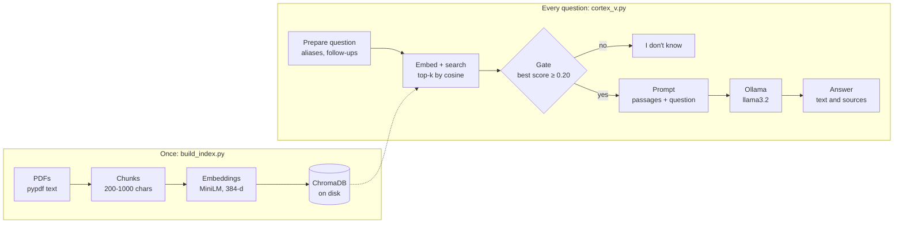

<div align="center">

# 📚 Notes Assistant

### Chat with your own PDF notes. 100% local. Zero cloud. Zero hallucination theater.


</div>

---

A local **Retrieval-Augmented Generation (RAG)** app. Drop your PDFs in a folder, index them once, and ask questions. Answers come **only** from your documents, with clickable sources, similarity scores, and a visual map of how your question relates to the retrieved passages.

Everything runs on your laptop: embeddings with **MiniLM**, vector search with **ChromaDB**, generation with **Ollama**. No API keys, no accounts, no data sent anywhere.

## ✨ Features

| | |
|---|---|
| 🔒 **Fully local** | Ollama + sentence-transformers + ChromaDB, all on disk and in RAM |
| 🧱 **Guardrails** | If the best match scores below a threshold, the LLM is never called and the app says *"I don't know based on the provided notes."* |
| 📎 **Cited sources** | Every answer shows the passages it used, with source file and similarity % |
| 🔭 **Detail graph** | Interactive 2D map (PCA) of your question vs. matched passages vs. the rest of your notes |
| 🔀 **Chunk-size switch** | Compare 200 / 500 / 1000 character chunking live from the sidebar |
| 🧠 **Smart queries** | Abbreviations expand automatically (`DL` → deep learning) and short follow-ups like *"explain it more"* reuse the previous topic |
| ⚡ **Streaming + warm-up** | Tokens stream as they're generated; the model is preloaded in the background so the first question isn't slow |
| 🎯 **Retrieval accuracy test** | One click hit-rate evaluation against your own question set |
| 🎨 **Polished UI** | Custom chat bubbles, dark sidebar, suggested questions, document stats |

## 🧭 How it works



1. **Indexing (once):** PDFs are read, split into overlapping chunks (10% overlap), embedded with `all-MiniLM-L6-v2` and stored in ChromaDB, one collection per chunk size.
2. **Question prep:** abbreviations are expanded and vague follow-ups are enriched with the previous question.
3. **Retrieval:** the question is embedded and the top-k closest passages are fetched. True cosine similarity is computed for each.
4. **Gate:** if even the best passage scores under `SIM_FLOOR` (0.20), the model is skipped entirely. No context means no improvising.
5. **Generation:** the passages and question go to `llama3.2` via Ollama with a strict "use ONLY this context" prompt, at temperature 0.1.
6. **Answer:** streamed text plus source popovers and the detail graph.

## 🚀 Quick start

### 1. Prerequisites

- **Python 3.10+**
- **[Ollama](https://ollama.com/download)** installed and running

### 2. Install

```bash
git clone <your-repo-url>
cd <your-repo>

python -m venv .venv
source .venv/bin/activate        # Windows: .venv\Scripts\activate

pip install streamlit chromadb ollama sentence-transformers plotly numpy pypdf
```

### 3. Pull the model

```bash
ollama pull llama3.2
```

### 4. Add your notes and build the index

```bash
mkdir data
# copy your PDFs into ./data

python build_index.py
```

This creates `notes_rag_200`, `notes_rag_500` and `notes_rag_1000` inside `./chroma_db`.

### 5. Configure Streamlit

Create `.streamlit/config.toml` next to `cortex_v.py` (light theme, dark sidebar, no Deploy button):

```toml
[theme]
base = "light"
primaryColor = "#2563eb"

[theme.sidebar]
backgroundColor = "#0b1220"
textColor = "#e2e8f0"

[client]
toolbarMode = "minimal"
```

### 6. Run

```bash
streamlit run cortex_v.py
```

Open the local URL Streamlit prints (usually http://localhost:8501) and start asking.

## 📁 Project structure

```
.
├── cortex_v.py            # Streamlit app: retrieval, guardrails, UI
├── build_index.py         # PDF → chunks → embeddings → ChromaDB
├── eval_set.json          # (optional) questions for the accuracy test
├── data/                  # your PDFs go here
├── chroma_db/             # generated vector store
└── .streamlit/
    └── config.toml        # theme + hidden Deploy button
```

## ⚙️ Configuration

Everything lives at the top of `cortex_v.py`:

| Setting | Default | What it does |
|---|---|---|
| `OLLAMA_MODEL` | `llama3.2` | Any model you've pulled with `ollama pull` |
| `EMBED_MODEL` | `all-MiniLM-L6-v2` | Must match the model used in `build_index.py` |
| `SIM_FLOOR` | `0.20` | Below this best-cosine score the LLM is not called. Raise it for stricter answers, lower it for more permissive ones |
| `SUGGESTIONS` | ML questions | Starter questions shown on the empty screen |
| `ALIASES` | `dl`, `ml`, `nlp`, … | Abbreviations expanded for search. Add your own domain terms |
| `GUARDRAIL_PHRASE` | *I don't know based on the provided notes.* | The refusal message |

And in `build_index.py`:

| Setting | Default | What it does |
|---|---|---|
| `CHUNK_SIZES` | `[200, 500, 1000]` | Chunk sizes (characters) to build |
| `OVERLAP_RATIO` | `0.10` | Overlap between neighbouring chunks |
| `MIN_CHARS` | `50` | Tiny chunks below this are dropped |

> 💡 Changed `EMBED_MODEL` or chunking? Re-run `python build_index.py` to rebuild the index.

## 🎯 Measuring retrieval quality

Create `eval_set.json` next to the app:

```json
[
  { "question": "What is the bias-variance tradeoff?", "expected_source": "ml_basics.pdf" },
  { "question": "Which metrics evaluate a classifier?", "expected_source": "evaluation.pdf" }
]
```

Then open **Settings → Test retrieval accuracy** in the sidebar. You get the **hit rate**: the percentage of questions where the expected PDF appears in the top-k results. Use it to compare chunk sizes and k values with real numbers instead of guessing.

## 🛠️ Troubleshooting

| Problem | Fix |
|---|---|
| Sidebar shows **"Ollama is offline"** | Start Ollama (`ollama serve`) and make sure `ollama list` shows `llama3.2` |
| `Collection 'notes_rag' not found` | Run `python build_index.py`, or check that `chroma_db/` is in the folder you launch from |
| `Found 0 PDFs` | Put `.pdf` files in `./data` (scanned image-only PDFs have no extractable text) |
| Always answers "I don't know" | Lower `SIM_FLOOR`, try a different chunk size, or check that your PDFs contain real text |
| First answer is slow | Normal: the model is loading into RAM. Later answers are much faster |
| Slow on CPU | Use a smaller model, or reduce **Passages per answer** to 2 |

## 🧰 Tech stack

- **[Streamlit](https://streamlit.io)** for the UI
- **[ChromaDB](https://www.trychroma.com)** for the vector store
- **[sentence-transformers](https://www.sbert.net)** with `all-MiniLM-L6-v2` (384-dim embeddings)
- **[Ollama](https://ollama.com)** running `llama3.2` locally
- **[pypdf](https://pypdf.readthedocs.io)** for PDF text extraction
- **[Plotly](https://plotly.com/python/)** for the detail graph

## 🗺️ Ideas for next steps

- Support `.txt` / `.md` / `.docx` files
- Hybrid search (BM25 + vectors) and a re-ranker
- Page numbers in the cited sources
- Conversation memory beyond the last question

---

<div align="center">

Built with ☕ and a healthy distrust of hallucinations.

</div>